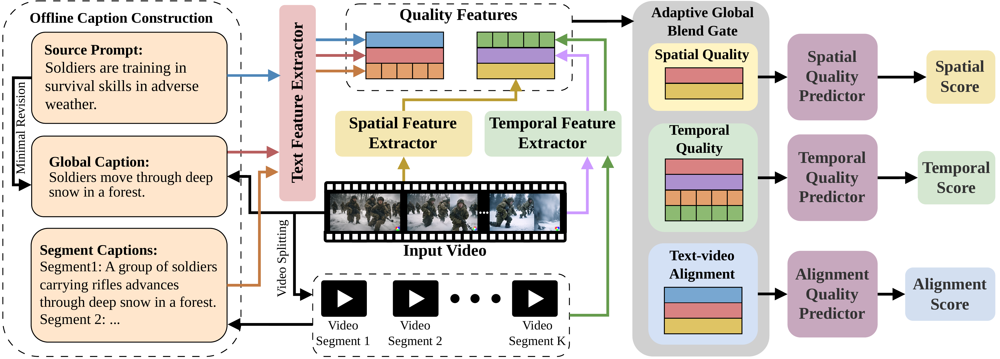

# Beyond Source Prompts: Towards Visually Grounded AI-Generated Video Quality Assessment

<p align="center">
  <a href="https://arxiv.org/abs/2610.21758"></a>
</p>

<p align="center">
  <a href="assets/framework.pdf">
    
  </a>
</p>
<p align="center">
  <em>Overall framework of VGCap. The Text Feature Extractor extracts features from the source prompt, global caption, and segment captions. The Spatial Feature Extractor derives frame-level spatial features. The Temporal Feature Extractor produces whole-video and segment-level motion features. The Adaptive Global Blend Gate fuses the branch-specific video and textual features, which are mapped to their corresponding scores by three quality predictors.</em>
</p>

Official implementation of VGCap's spatial, temporal, and text-video alignment assessment branches. VGCap is a multidimensional AI-generated video quality assessment framework that integrates visually grounded captions with video features through the Adaptive Global Blend Gate (AGBG).

## 🛠️ Installation

```bash
git clone https://github.com/lolo123-123/VGCap.git
cd VGCap
conda create -n vgcap python=3.10.12 -y
conda activate vgcap
pip install torch==2.12.1 torchvision==0.27.1 --index-url https://download.pytorch.org/whl/cu126
```

For x86_64, run:

```bash
pip install decord==0.6.0
```

For ARM64/GH200, skip the pip command above and run:

```bash
conda install -c conda-forge decord==0.6.0
```

Then install the remaining dependencies:

```bash
pip install -r requirements.txt
```

## 📁 Data Preparation

Prepare the original videos and prompt-disjoint split CSV files with the following columns:

| Branch | Required CSV columns |
| --- | --- |
| Spatial | `video_name`, `Global_Caption`, `Spatial_MOS` |
| Temporal | `video_name`, `Global_Caption`, `Segment_Captions`, `segment_plan`, `Temporal_MOS` |
| Alignment | `video_name`, `Prompt`, `Global_Caption`, `Alignment_MOS` |

The spatial and alignment branches read the original videos directly. For the temporal branch, `segment_plan` is a JSON string containing 1-4 segments with eight source-frame indices per segment. The extractor uses `segment_id` and `source_frame_indices`; the remaining fields record frame boundaries, local model-frame indices, and timestamps. Examples for 16-frame and 64-frame videos are provided in [`examples/segment_plan_example.json`](examples/segment_plan_example.json).

SlowFast whole-video and segment features are saved as `whole_motion_feature` and `segment_motion_features`; BLIP global and segment caption features are stored as `global_caption_feature` and `segment_caption_features`. Each `.pt` feature file follows the relative path in `video_name`, with the video extension replaced by `.pt`.

Extract the frozen SlowFast and BLIP features for the temporal branch with:

```bash
bash shell/extract/extract_motion_features.sh
bash shell/extract/extract_caption_features.sh
```

### Caption Construction and Examples

For the global caption, all frames are retained for videos with at most 32 frames; otherwise, 32 frames are uniformly sampled. Qwen3-VL-8B decomposes the source prompt into six descriptive components, and VideoLLaMA3-7B independently describes the same components from the sampled frames. Qwen3-VL-8B verifies each prompt component as supported, contradicted, or uncertain. Supported and uncertain components are retained, whereas contradicted components are replaced with the corresponding visually grounded descriptions. The resulting components are recomposed while preserving the source-prompt sentence structure as closely as possible.

For segment captions, videos are evenly divided into one to four non-overlapping temporal segments according to their length, and up to eight frames are uniformly sampled from each segment. VideoLLaMA3-7B generates each caption using only its segment frames, and Qwen3-VL-8B verifies the result. An explicitly inconsistent caption is revised once and verified again.

Four examples are provided in [`examples/caption_examples.json`](examples/caption_examples.json). The corresponding videos are not redistributed; users should obtain them from the original dataset under its access and licensing terms.

## 🌈 Training

```bash
bash shell/train/train_spatial.sh
bash shell/train/train_temporal.sh
bash shell/train/train_alignment.sh
```

## 🌈 Evaluation

```bash
bash shell/eval/eval_spatial.sh
bash shell/eval/eval_temporal.sh
bash shell/eval/eval_alignment.sh
```

## 📌 TODO

- ✅ Release the training code for the three quality assessment branches
- ✅ Release the evaluation code for the three quality assessment branches
- ✅ Add examples of `Global_Caption` and `Segment_Captions`
- ✅ Add a `segment_plan` example

## 📧 Contact

For questions, please contact `or24760@bristol.ac.uk`.

## 🎓 Citation

If you find VGCap useful, please cite:

```bibtex
@article{zhou2026vgcap,
  title={Beyond Source Prompts: Towards Visually Grounded AI-Generated Video Quality Assessment},
  author={Zhou, Kehao and Li, Yixuan and Jiang, Yuxuan and Zhang, Fan},
  journal={arXiv preprint arXiv:2610.21758},
  year={2026}
}
```
